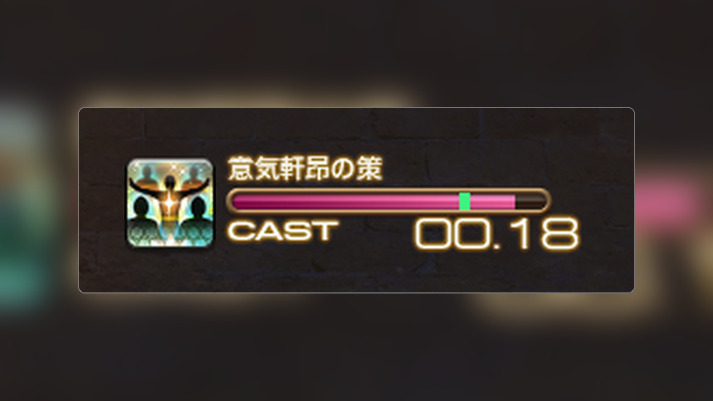

<p align="center">
  
</p>

<h1 align="center">SlideGuide</h1>

<p align="center">
  English | <a href="docs/README.ja.md">日本語</a>
</p>

<p align="center">
  <a href="https://github.com/exatrines/SlideGuide/releases/latest">
    
  </a>
  <a href="CHANGELOG.md">
    
  </a>
  <a href="LICENSE">
    
  </a>
</p>

<p align="center">
  
</p>

Draws slidecast timing as an overlay on the native castbar. It is only a guide; game frame rate and similar factors can make the actual result differ.

## Install

1. Run `/xlsettings` and open the **Experimental** tab
2. Add this URL under **Custom Plugin Repositories**:

```
https://raw.githubusercontent.com/exatrines/DalamudPlugins/refs/heads/main/pluginmaster.json
```

3. Run `/xlplugins` and install **SlideGuide**

## Features

- **Overlay marker** — A vertical line on the native castbar at your slidecast threshold. The HUD itself is not modified.
- **Appearance** — Threshold, line width, extra height, and before/after colors.

## Commands

| Command | Description |
| --- | --- |
| `/slideguide` | Toggle settings |

## For developers

1. `git submodule update --init --recursive`
2. Build: `dotnet build SlideGuide.sln -c Release -p:Platform=x64`
3. Point Dalamud’s **dev plugin** path at `SlideGuide/bin/Release/`
4. Enable **SlideGuide** in the plugin installer (dev)

[MirageUI](https://github.com/exatrines/MirageUI) is included as a git submodule for the shared UI kit.

## Contributing

Contributions are always welcome! Please see the [contribution guide](CONTRIBUTING.md).
